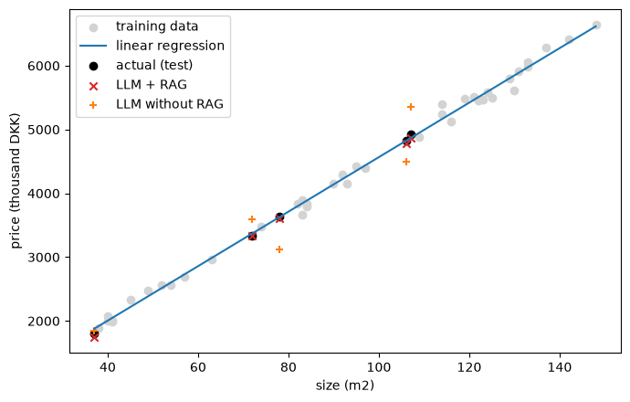

# Linear Regression vs. Local LLM + RAG

*Comparison exercise for the exam project "LLM for Developers".*

---

## 1. Question

Can a local LLM that receives retrieved examples (RAG) predict the same number as a linear regression model trained on the full dataset? And what does the comparison show about when each approach is the right tool?

The exam does not expect the LLM to win. The aim is to compare two different approaches to the same numerical task and to explain the differences from **measured** results.

## 2. Task and data

| | |
|---|---|
| Task | Predict the sale price of an apartment from its size |
| Input | `size_m2`, the size in square metres |
| Target | `price_kdkk`, the sale price in thousand DKK |
| Data | 45 synthetic rows: `price = 42 · size + 350 + noise`, noise normally distributed with standard deviation 120, sizes drawn between 30 and 150 m² (the 45 rows span 37 to 148 m²), random seed 42 |
| Split | 40 training/reference rows and 5 held-out test cases (`train_test_split`, `random_state=42`) |
| Test inputs | 37, 72, 78, 106 and 107 m² |

**Why synthetic data.** It is reproducible, contains no personal data, and the relationship is linear by construction. The last point also favours the regression model, which is a limitation of the experiment (see section 7).

**One detail worth noting.** The smallest test case (37 m²) is just below the smallest training example (38 m²), so it is a small extrapolation.

**No leakage.** The test prices are kept in a separate variable (`y_test`) and are only read in the comparison step. Neither approach sees them.

> **[PASTE: optional scatter plot of the training data]**

## 3. Approach A: linear regression

- Model: scikit-learn `LinearRegression`, fitted on the 40 training rows only.
- Learned line: `price = 42.70 · size + 296.52` (the line that generated the data is `42 · size + 350`).
- Predictions for the 5 test cases: 1876, 3371, 3627, 4822 and 4865 thousand DKK.

## 4. Approach B: local LLM + RAG

### 4.1 Setup

| Component | Choice |
|---|---|
| Chat model | `qwen3:4b` via Ollama (thinking switched off, temperature 0) |
| Embedding model | `nomic-embed-text` via Ollama (768-dimensional vectors) |
| Retrieval | Cosine similarity over all chunks, top 5 (`TOP_K = 5`), implemented with NumPy |
| Hardware | MSI MS-7D75 desktop, AMD Ryzen 9 7900X 12-Core Processor, 32 GB RAM, NVIDIA GeForce RTX 5070 Ti (also includes AMD Radeon Graphics) |

The experiment is intended to be runnable on a regular school laptop and does not require hardware as powerful as the desktop used for this project. However, execution may take longer on a laptop with less processing power or memory, particularly when running the local language model.

### 4.2 The RAG collection

The collection has **41 chunks**: one short background note and one sentence per **training** row, for example:

```
An apartment of 84 m2 sold for 3798 thousand DKK.
```

Each training row is its own chunk, so a row is never split in half (which would happen with chunking by character count). **No test row is in the collection.** The collection is saved in `rag_data/rag_collection.txt` so it can be inspected.

### 4.3 How a prediction is made

```
question ("Predict the price of an apartment of 78 m2")
   -> embedding model -> 768 numbers
   -> cosine similarity against all 41 chunk vectors
   -> the 5 most similar chunks
   -> pasted into the prompt as "Context:" followed by the question
   -> qwen3:4b -> reply -> price extracted from the reply
```

The model itself is unchanged and is not trained on the data. The only difference between "with RAG" and "without RAG" is the text it receives.

### 4.4 Prompt (4T's)

```
Traits: You are a careful data analyst who estimates numbers from the examples you are given.
Task: Predict the sale price of an apartment from its size, using the example sales in the context.
Tone: Precise and matter-of-fact. No explanations.
Target: A script that reads your answer. Reply with ONLY one number: the price in thousand DKK, no unit and no text.
```

The user message is `Context:` followed by the 5 retrieved chunks, then `Predict the sale price (in thousand DKK) of an apartment of {size} m2.`

### 4.5 Reading the answer

The model often ignored "reply with ONLY one number" and wrote a short derivation first, so the price has to be extracted from the text. The rules used:

- A short reply with exactly one number is the answer.
- Otherwise, a marked answer (`Answer: ...`, `**Answer**: ...` or `\boxed{...}`).
- Anything else counts as unreadable. The question is asked again (up to 3 attempts, retries at a small temperature), and if all attempts fail the result is NaN.

> **[Check]** Make sure this matches the notebook version you actually ran.

### 4.6 Rules from the exam

- The RAG collection only holds training rows and background text.
- The LLM never calls the regression model and never executes code. Everything it computes, it computes in its own text.
- Results are reported as measured, including failures.

### 4.7 Optional baseline: LLM without RAG

The same question without any context. This is an extra baseline, not an exam requirement. It shows what the model brings on its own.

> The no-RAG baseline was run using the same LLM, test questions, and 4Ts prompt structure as the RAG approach, but without providing any retrieved apartment examples as context. The task and output requirements remained the same; only the instruction to use the examples in the context was replaced with an instruction to use general knowledge, allowing us to compare the model's predictions with and without access to the dataset.

## 5. Results

Absolute error is `|prediction - actual|`, and MAE is the mean absolute error over the test cases. Units are thousand DKK.

> The skeleton below already has the actual values and the regression results. Fill in the LLM columns, or replace the whole table with the notebook's output.

| size_m2 | actual | regression | llm_rag | llm_no_rag | abs_err_regression | abs_err_llm_rag | abs_err_llm_no_rag |
| ------- | ------ | ---------- | ------- | ---------- | ------------------ | --------------- | ------------------ |
| 37      | 1800   | 1876.0     | 1741.0  | 1850.0     | 76.0               | 59.0            | 50.0               |
| 72      | 3332   | 3371.0     | 3340.0  | 3600.0     | 39.0               | 8.0             | 268.0              |
| 78      | 3634   | 3627.0     | 3610.0  | 3120.0     | 7.0                | 24.0            | 514.0              |
| 106     | 4822   | 4822.0     | 4777.0  | 4500.0     | 0.0                | 45.0            | 322.0              |
| 107     | 4925   | 4865.0     | 4864.0  | 5350.0     | 60.0               | 61.0            | 425.0              |


### 5.1 Figure
>
> *To save it from the notebook, add `plt.savefig("figures/regression_vs_rag.png", dpi=200)` just before `plt.show()` in the plotting cell (and create the folder with `Path("figures").mkdir(exist_ok=True)`). Then keep the line below.*



### 5.2 What was retrieved

The exam asks you to document what the LLM retrieved. Example from our run, for the 37 m² question:

| Rank | Similarity | Retrieved chunk |
|---:|---:|---|
| 1 | 0.899 | An apartment of 84 m2 sold for 3798 thousand DKK. |
| 2 | 0.898 | An apartment of 57 m2 sold for 2688 thousand DKK. |
| 3 | 0.896 | An apartment of 84 m2 sold for 3840 thousand DKK. |
| 4 | 0.893 | An apartment of 63 m2 sold for 2956 thousand DKK. |
| 5 | 0.892 | An apartment of 137 m2 sold for 6283 thousand DKK. |

> ### Additional retrieval examples

The following tables show the five chunks retrieved for the remaining test apartments, ranked by cosine similarity.

**For the 72 m² question:**

| Rank | Similarity | Retrieved chunk |
|---:|---:|:---|
| 1 | 0.896 | An apartment of 148 m2 sold for 6640 thousand DKK. |
| 2 | 0.896 | An apartment of 74 m2 sold for 3472 thousand DKK. |
| 3 | 0.895 | An apartment of 142 m2 sold for 6419 thousand DKK. |
| 4 | 0.894 | An apartment of 84 m2 sold for 3798 thousand DKK. |
| 5 | 0.892 | An apartment of 63 m2 sold for 2956 thousand DKK. |

**For the 78 m² question:**

| Rank | Similarity | Retrieved chunk |
|---:|---:|:---|
| 1 | 0.903 | An apartment of 148 m2 sold for 6640 thousand DKK. |
| 2 | 0.901 | An apartment of 82 m2 sold for 3838 thousand DKK. |
| 3 | 0.900 | An apartment of 84 m2 sold for 3798 thousand DKK. |
| 4 | 0.898 | An apartment of 114 m2 sold for 5233 thousand DKK. |
| 5 | 0.897 | An apartment of 57 m2 sold for 2688 thousand DKK. |

**For the 106 m² question:**

| Rank | Similarity | Retrieved chunk |
|---:|---:|:---|
| 1 | 0.898 | An apartment of 137 m2 sold for 6283 thousand DKK. |
| 2 | 0.897 | An apartment of 148 m2 sold for 6640 thousand DKK. |
| 3 | 0.894 | An apartment of 114 m2 sold for 5233 thousand DKK. |
| 4 | 0.893 | An apartment of 130 m2 sold for 5608 thousand DKK. |
| 5 | 0.892 | An apartment of 109 m2 sold for 4886 thousand DKK. |

**For the 107 m² question:**

| Rank | Similarity | Retrieved chunk |
|---:|---:|:---|
| 1 | 0.897 | An apartment of 137 m2 sold for 6283 thousand DKK. |
| 2 | 0.896 | An apartment of 148 m2 sold for 6640 thousand DKK. |
| 3 | 0.896 | An apartment of 109 m2 sold for 4886 thousand DKK. |
| 4 | 0.894 | An apartment of 114 m2 sold for 5233 thousand DKK. |
| 5 | 0.893 | An apartment of 131 m2 sold for 5917 thousand DKK. |

**Observation:** The retrieval results show that the system consistently retrieves apartment-sale examples. However, the retrieved apartments are not always the closest in size to the test apartment. For example, the 72 m² query retrieves apartments of 148 m² and 142 m² among its top results. This illustrates that cosine similarity measures semantic similarity between embeddings rather than numerical distance between apartment sizes.

## 6. Findings

The results show that providing the LLM with retrieved apartment examples substantially improves its price estimates compared with relying on the model alone. This suggests that access to relevant, dataset-specific information is important for this task.

Although RAG brought the LLM's performance close to that of linear regression, it did not outperform the regression model. This indicates that retrieval can make an LLM more useful for data-driven estimation, but does not necessarily make it the best-performing approach.

### 6.1 Accuracy

The linear regression model reached an MAE of **36.4 thousand DKK**. The LLM + RAG model reached an MAE of **39.4 thousand DKK**, which is approximately **1.08 times higher** than the linear regression model. The largest LLM + RAG error was **61 thousand DKK** at **107 m²**, and the smallest was **8 thousand DKK** at **72 m²**.

The no-RAG baseline reached an MAE of **315.8 thousand DKK**. Adding RAG substantially improved the LLM's accuracy, reducing its MAE by approximately **87.5%** compared with the no-RAG baseline. However, the RAG model's MAE was still slightly higher than that of the linear regression model.

### 6.2 Observations from the runs

1. **Retrieval does not find the numerically closest rows.** For the 37 m² question, the closest training examples (38 to 41 m²) were not retrieved. The model received 57 to 137 m² examples instead. All similarity scores were between about 0.89 and 0.90, so the embedding model barely distinguishes the rows. Embeddings capture what a text is about, not how close two numbers are.

2. **The model imitates statistics in words.** Without being given any code, it interpolated between the two nearest examples (72 m²: between 63 m² and 74 m²), averaged the price per square metre (106 m² and 37 m²), and once wrote out a regression formula with a slope and intercept in its answer. This stays inside the exam rules, because it did not call the regression model or run code, but it is a language-based approximation of arithmetic, not a fitted model.

3. **Formatting instructions are not reliable.** Asked for "only one number", the model wrote derivations. A first parser that took the first number in the reply returned 37, 72, 43.64 and 1 (an apartment size, a slope and a list marker). A fallback that took the last number turned an off-topic reply into the prediction 130. Reading and validating the answer is part of the experiment, because a wrong parser looks exactly like a wrong model.

4. **One reply was about something completely different.** For 107 m² the model answered a question about a JSON file for a game character, the same way in two runs. It disappeared after unloading the model with `ollama stop qwen3:4b`, which points to stale model state in Ollama and not to the prompt or the data.

5. **Even at temperature 0, results are not fully repeatable.** The identical question for 37 m² returned 1708 in one run and 1754 in another.

### 6.3 Why the approaches differ

| | Linear regression | Local LLM + RAG |
|---|---|---|
| What happens to the data | Fitted: the line is the least-squares solution over all 40 training rows | Not trained on. At most 5 rows are shown in the prompt |
| Output | Deterministic and exact to the model | Text from which a number is extracted, can vary between runs |
| Explanation | Two numbers: slope 42.70 and intercept 296.52 | A written derivation that may or may not be correct |
| Speed and cost | Milliseconds | Seconds to minutes per question on a laptop |
| Sensitivity | Uses every row equally | Depends on which rows retrieval happens to select |

The regression model has the right form for this data: the data is linear by construction, and the model uses all 40 rows. The LLM sees a handful of rows chosen by a text-similarity measure and has to reason from them.

### 6.4 Was RAG useful?

Yes. The no-RAG baseline showed that the LLM had some general understanding of apartment prices and could produce estimates within a plausible price range. However, its predictions were often inaccurate, suggesting that general knowledge alone was not sufficient for this task.

Retrieving apartment-sale examples gave the model concrete, dataset-specific information about the relationship between apartment size and sale price. This helped it make more accurate estimates, reducing the MAE from 315.8 to 39.4 thousand DKK. The results suggest that RAG was useful because it grounded the model's estimates in actual examples from the dataset rather than relying only on its general knowledge.

### 6.5 When is a trained model preferable?

- Numerical, tabular data with a clear relationship, as here.
- When you need the same answer every time, quickly and cheaply.
- When the result must be explainable and checkable (coefficients, error measures).
- When many predictions are needed.

LLM + RAG is the better fit when the information is text, when there is no labelled dataset or training pipeline, and when a natural-language explanation is part of the product.

## 7. Limitations and possible improvements

### Limitations

- Only 5 test cases from one split and one random seed, so a single case can change the conclusion.
- Synthetic, exactly linear data favours the regression model.
- A small model (4B parameters) was used locally, which limits its reasoning capabilities.
- Embedding-based retrieval is poor at identifying numerical closeness (see Section 6.2).
- Some replies were off-topic or incorrectly formatted, making answer parsing less reliable.
- The model sometimes attempted to calculate a regression line from retrieved examples rather than simply using them as comparable cases.
- Results may vary between runs, even with the same prompt and settings.

### Possible improvements

- More test cases and several random seeds, with the MAE averaged across them.
- Test `TOP_K = len(chunks)` (all rows in the prompt) to see whether retrieval is the bottleneck.
- Retrieve by numerical closeness (nearest apartment sizes) instead of, or together with, embeddings.
- Use a larger local model, if the hardware allows it.
- Clarify the price unit and presentation. Expressing prices in thousands of DKK can be confusing, as readers may interpret it as thousands of thousands of DKK. Using full DKK values or clearly labelling the unit as "thousand DKK" throughout would make the results easier to understand.

## 8. Conclusion

Linear regression was the most accurate approach, with an MAE of 36.4 thousand DKK compared with 39.4 thousand DKK for LLM + RAG and 315.8 thousand DKK for the LLM without RAG. Regression performed best because it directly learned the relationship between apartment size and price, while the LLM relied on retrieved examples and its ability to interpret them. RAG substantially improved the LLM's predictions, reducing its MAE by approximately 87.5% compared with using the LLM alone. For this type of structured, approximately linear data, I would choose linear regression for accuracy, while RAG would be useful when working with an LLM that needs access to specific dataset information or when the task requires more flexible, natural-language reasoning.

---

## Appendix A. Reproducing the experiment

To reproduce the experiment, install the required Ollama models and Python dependencies:

```bash
ollama pull qwen3:4b
ollama pull nomic-embed-text
uv sync
```

Open `linear_regression_vs_rag.ipynb` and run the cells from top to bottom.

- **Files:** The notebook, `rag_data/rag_collection.txt` (the full RAG collection), and `figures/` (generated plots).
- **Versions:** Record the output of `ollama --version` and `ollama list` to document the Ollama version and installed models.
- **Troubleshooting:** If the model produces off-topic replies, unload it with `ollama stop qwen3:4b` and run the relevant notebook cell again.

## Appendix B. Raw replies (optional)

The following examples show the raw LLM + RAG responses for two test cases. They are included to illustrate the model's reasoning process, the retrieved examples provided as context, and how the model arrived at its price estimates.

### Test case: 37 m²

**Retrieved examples:**
- 84 m² — 3,798 thousand DKK
- 57 m² — 2,688 thousand DKK
- 84 m² — 3,840 thousand DKK
- 63 m² — 2,956 thousand DKK
- 137 m² — 6,283 thousand DKK

**Raw model reply:**

[Paste the raw 37 m² RAG response here.]

### Test case: 72 m²

**Retrieved examples:**
- 148 m² — 6,640 thousand DKK
- 74 m² — 3,472 thousand DKK
- 142 m² — 6,419 thousand DKK
- 84 m² — 3,798 thousand DKK
- 63 m² — 2,956 thousand DKK

**Raw model reply:**

[Paste the raw 72 m² RAG response here.]

---